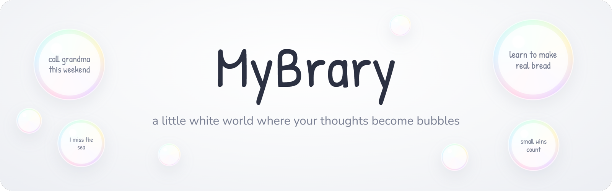
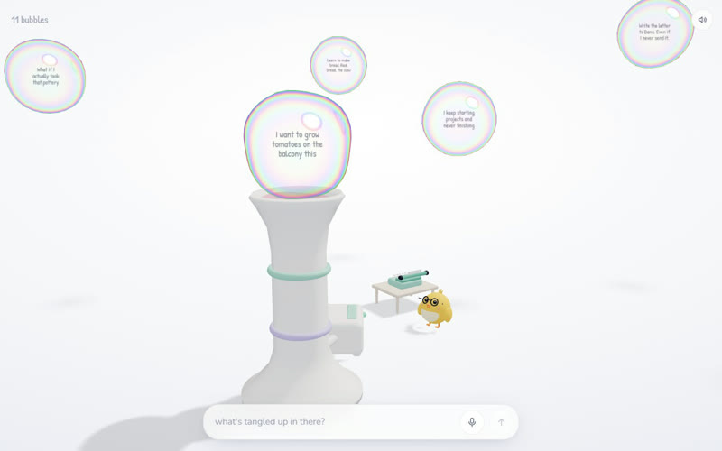
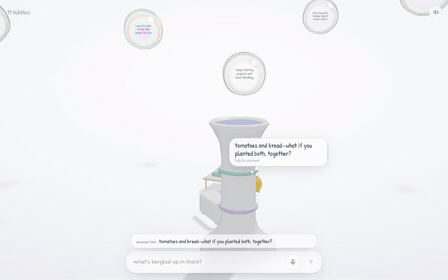
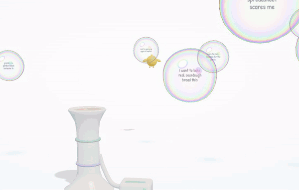
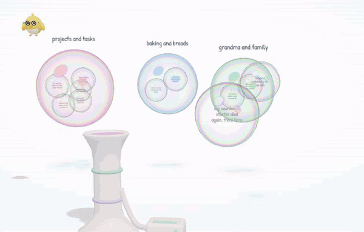
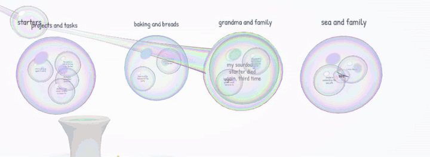
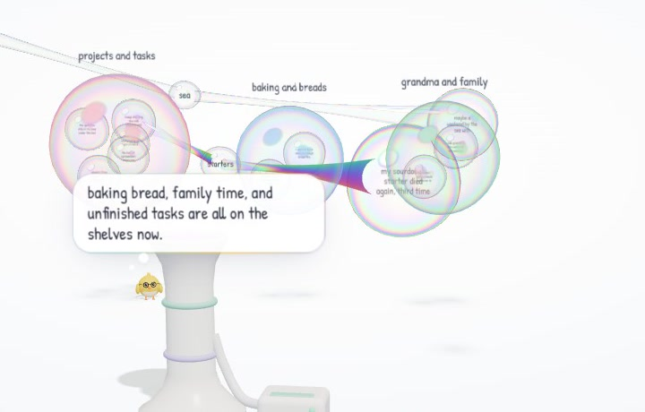

<p align="center">
  
</p>

<p align="center">
  Say what's on your mind. A little bird types it up,<br>
  and it floats away as a bubble.
</p>

<p align="center">
  
</p>

## How it goes

<table>
  <tr>
    <td align="center" width="33%"><br><b>1 · Write it</b><br><sub>or just say it out loud</sub></td>
    <td align="center" width="33%"><br><b>2 · Let it go</b><br><sub>it becomes a bubble</sub></td>
    <td align="center" width="33%"><br><b>3 · The bird wonders</b><br><sub>tap its question to answer</sub></td>
  </tr>
  <tr>
    <td align="center" colspan="2"><br><sub>Tap any bubble to read it again</sub></td>
    <td align="center"><br><sub>Works on your phone too</sub></td>
  </tr>
</table>

## The bird's library

The bubbles are all the bird knows, and it wants them tidy.
It reads every bubble to the end, remembers the names in it, and only says what you actually wrote.

<table>
  <tr>
    <td align="center" width="50%"><br><b>🫧 It sorts</b><br><sub>new shelves, bubbles carried in one by one</sub></td>
    <td align="center" width="50%"><br><b>🔗 It links</b><br><sub>one word for why two bubbles belong together</sub></td>
  </tr>
  <tr>
    <td align="center"><br><b>✋ You rearrange</b><br><sub>drag bubbles, rename and recolour shelves</sub></td>
    <td align="center"><br><b>🐦 It thinks</b><br><sub>writes its own thoughts, and leaves you small steps to tick off</sub></td>
  </tr>
</table>

## Talk to the bird

Tap the little bird button next to the mic. Nothing you say there becomes a bubble.

New here? A short tour shows you around on your first visit, and the **?** button brings the guide back any time.

| | |
|---|---|
| 💬 **Ask it** | "what did I say about the trip?" It answers only from your bubbles, and they glow. |
| 📝 **Tell it** | "keep work and home apart." It remembers, and sorts by it. |
| 🙅 **Wave a question away** | "not this one", and it won't ask that again. |
| ❓ **Ask why** | Open a bubble or a link to see the words it went by. |
| 🏷️ **Name what belongs** | Every shelf has one line saying what goes on it. Yours beats the bird's. |
| 🔍 **Find** | Type a word. Matching bubbles glow and the camera flies over. |
| 🔁 **What keeps coming back** | It counts names across the month's bubbles. It doesn't guess. |
| 💤 **Later** | Put a small step off, and it comes back in a few days. |
| 🕰️ **Old bubbles fade** | The bird dusts one off and asks if it's still true. |

## Get it running

You need [Node.js](https://nodejs.org) and [Ollama](https://ollama.com/download).

```bash
git clone https://github.com/tomerasraf/mybrary.git
cd mybrary
npm install
ollama pull qwen3:8b     # the bird's brain, about 5 GB
npm run dev
```

Open **http://localhost:3000** and write your first thought. 🫧

<details>
<summary><b>📱 On your phone</b></summary>
<br>

1. Copy `.env.example` to `.env.local` and set an `APP_PASSCODE`, so nobody else on your Wi-Fi can get in.
2. Run `npm run dev:https` (the mic needs https).
3. On your phone, open `https://<your-computer's-ip>:3000`, accept the certificate warning once, and tap **Add to Home Screen**.

Voice works in Chrome, Edge and Safari.
</details>

<details>
<summary><b>⚙️ Settings</b></summary>
<br>

All optional. Put them in `.env.local`.

| Setting | What it does |
| --- | --- |
| `APP_PASSCODE` | Asks for a passcode before opening |
| `OLLAMA_MODEL` | Give the bird another brain, e.g. `gemma3:12b` |
| `OLLAMA_THINK=true` | Slower, deeper questions |
| `ANTHROPIC_API_KEY` | Claude as a backup when Ollama is off |
| `MYBRARY_DB` | Where your bubbles are saved |
</details>

## Yours, and only yours

- 🏠 Your bubbles are saved on your own computer, in `data/`.
- 🐦 The bird thinks on your computer too.
- 🔒 Nothing you write is ever uploaded to git. Your keys aren't either.

<sub>If you add a Claude key and Ollama is off, the bird sends your bubbles to Claude to think. Chrome's voice typing uses Google's servers.</sub>

## Make it your own

Fork it, change it, give the bird a new hat. It's MIT licensed, so it's yours to play with.

<details>
<summary><b>🗺️ Where things live</b></summary>
<br>

| Folder | What's inside |
| --- | --- |
| `src/world/` | The 3D world: the tube, the desk, the bird, bubbles, shelves, links, sounds |
| `src/components/` | The text box, voice input, the pages and cards you open |
| `src/lib/` | Saving thoughts, shelves and links, the bird's notebook |
| `src/lib/ai/` | The bird's brain: wondering, sorting, writing |
| `_archive/` | An older version, kept for ideas |

```bash
npm test
npm run typecheck
```
</details>

<p align="center"><sub>Made with care · <a href="LICENSE">MIT</a></sub></p>
