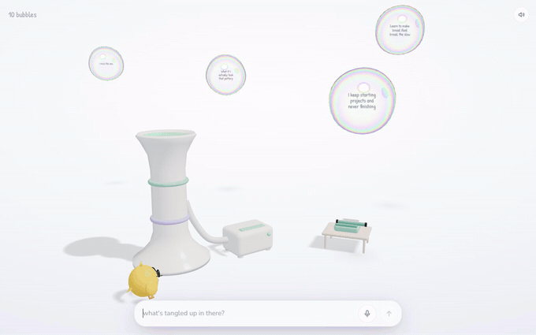
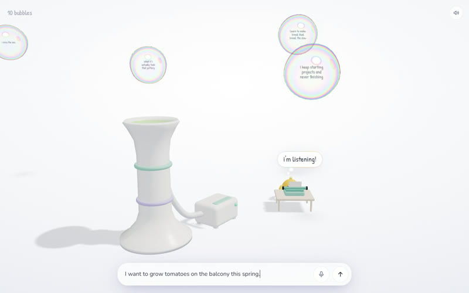
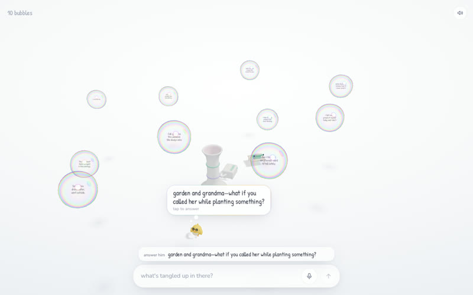
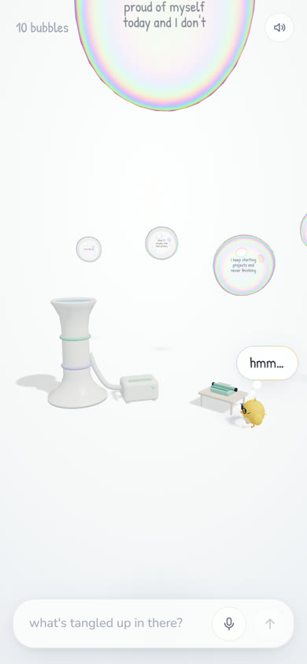

<p align="center">
  
</p>

<p align="center">
  Empty your head and leave lighter. Say what's on your mind, a little bird listens,<br>
  and keeps one short page so you never have to read it all again.
</p>

<p align="center">
  
</p>

## How it goes

<table>
  <tr>
    <td align="center" width="33%"><br><b>1 · Write it</b><br><sub>or just say it out loud</sub></td>
    <td align="center" width="33%"><br><b>2 · Let it go</b><br><sub>it becomes a bubble</sub></td>
    <td align="center" width="33%"><br><b>3 · The bird asks one question</b><br><sub>tap it to answer, or wave it away</sub></td>
  </tr>
  <tr>
    <td align="center" colspan="2"><br><sub>Tap a floating bubble to read it</sub></td>
    <td align="center"><br><sub>Works on your phone too</sub></td>
  </tr>
</table>

## One page, an empty sky

A second messy place is no help to a messy mind. So nothing piles up here.

| | |
|---|---|
| 🫧 **Bubbles leave** | A thought floats only until the bird has taken it in. Then it drifts up and away. Nothing is deleted. |
| 📄 **One page** | "On your mind": a few lines, each one thing and where it stands. The bird rewrites it after every thought. |
| ✅ **One small step** | At most one, taken from something you said you want to do. Tick it, or × if it isn't for you. |
| 🐦 **A quiet bird** | It asks one question per thought, at most, and otherwise keeps to itself. It never comments on what you said. |

## Talk to the bird

Tap the little bird button next to the mic. Nothing you say there becomes a bubble.

New here? A short tour shows you around on your first visit, and the **?** button brings the guide back any time.

| | |
|---|---|
| 💬 **Ask it** | "what did I say about the trip?" It answers only from what you've told it. |
| 📝 **Tell it** | "Dana is my sister." It remembers, and the page uses your names. |
| 🙅 **Wave a question away** | "not this one", and it won't ask that again. |
| 🔍 **Find** | You don't have to look back. But type a word, and anything you ever said with it opens. |

## Get it running

You need [Node.js](https://nodejs.org) and [Ollama](https://ollama.com/download).

```bash
git clone https://github.com/tomerasraf/mybrary.git
cd mybrary
npm install
ollama pull qwen3:8b     # the bird's brain, about 5 GB
npm run dev
```

Open **http://localhost:3000** and write your first thought. 🫧

<details>
<summary><b>📱 On your phone</b></summary>
<br>

1. Copy `.env.example` to `.env.local` and set an `APP_PASSCODE`, so nobody else on your Wi-Fi can get in.
2. Run `npm run dev:https` (the mic needs https).
3. On your phone, open `https://<your-computer's-ip>:3000`, accept the certificate warning once, and tap **Add to Home Screen**.

Voice works in Chrome, Edge and Safari.
</details>

<details>
<summary><b>⚙️ Settings</b></summary>
<br>

All optional. Put them in `.env.local`.

| Setting | What it does |
| --- | --- |
| `APP_PASSCODE` | Asks for a passcode before opening |
| `OLLAMA_MODEL` | Give the bird another brain, e.g. `gemma3:12b` |
| `OLLAMA_THINK=true` | Slower, deeper questions |
| `ANTHROPIC_API_KEY` | Claude as a backup when Ollama is off |
| `MYBRARY_DB` | Where your bubbles are saved |
</details>

## Yours, and only yours

- 🏠 Your bubbles are saved on your own computer, in `data/`.
- 🐦 The bird thinks on your computer too.
- 🔒 Nothing you write is ever uploaded to git. Your keys aren't either.

<sub>If you add a Claude key and Ollama is off, the bird sends your bubbles to Claude to think. Chrome's voice typing uses Google's servers.</sub>

## Make it your own

Fork it, change it, give the bird a new hat. It's MIT licensed, so it's yours to play with.

<details>
<summary><b>🗺️ Where things live</b></summary>
<br>

| Folder | What's inside |
| --- | --- |
| `src/world/` | The 3D world: the tube, the desk, the bird, bubbles, shelves, links, sounds |
| `src/components/` | The text box, voice input, the pages and cards you open |
| `src/lib/` | Saving thoughts, shelves and links, the bird's notebook |
| `src/lib/ai/` | The bird's brain: wondering, sorting, writing |
| `_archive/` | An older version, kept for ideas |

```bash
npm test
npm run typecheck
```
</details>

<p align="center"><sub>Made with care · <a href="LICENSE">MIT</a></sub></p>
